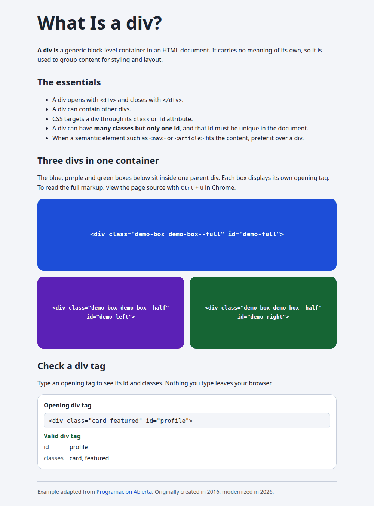

# what-is-a-div

**What Is a div?** A short interactive lesson on the HTML `<div>` element, with no runtime dependencies.

[](https://juanmafx.github.io/what-is-a-div/)

> **Project history:** originally created in 2016, modernized in 2026. The repository name is kept from the original Spanish title.

## Purpose

The page teaches one concept: what a `div` is and how it relates to nesting, classes and ids.

## Why this project exists

The `div` is among the first elements a new web developer meets, and it is easy to misuse. This project gives beginners one small page whose source is short enough to read in full, with an example that displays its own markup.

## What it does

- Explains what a `div` is and when a semantic element is the better choice.
- Shows three colored `div` boxes nested in one parent, each labeled with its real opening tag.
- Provides a live checker that reads an opening `div` tag and reports its id, its classes and common mistakes, such as a second `id`, an empty `id`, a self-closed `div` or malformed attribute syntax. It checks one tag and is not a full HTML validator.

All processing happens in the browser. The page has no backend, no accounts, no forms that submit, no cookies, no analytics and no third-party requests.

## Architecture

```text
.
├── index.html              Lesson page and content security policy
├── assets/
│   ├── scripts/
│   │   ├── main.js         Browser entry point
│   │   ├── domain/         Pure tag parsing, no DOM access
│   │   └── ui/             DOM rendering and messages
│   └── styles/             Base, layout, demo and inspector styles
├── db/schema.sql           Optional SQLite schema for test results
├── docs/                   Architecture and security audit
├── reports/tests/          Committed report from a real test run
├── scripts/                Test report generator
└── tests/                  Unit, DOM and schema suites
```

See [docs/ARCHITECTURE.md](docs/ARCHITECTURE.md) for the design rationale.

## Quick start

Requirements: a modern browser and Python 3 to serve the files. Node.js `^24.15.0 || >=26.0.0` is needed only for the tests.

```bash
git clone https://github.com/juanmafx/Que-es-un-div.git
cd what-is-a-div
npm start
```

Open <http://127.0.0.1:8080/>. The page must be served over HTTP because browsers block ES modules on `file://` URLs. Without that, the lesson still reads correctly and only the checker is inactive.

## Usage guide

1. Read the essentials and compare them with the three demo boxes.
2. Press <kbd>Ctrl</kbd> + <kbd>U</kbd> in Chrome to view the page source.
3. In **Check a div tag**, edit the sample. For example, try:

| Input | Result |
| --- | --- |
| `<div class="card featured" id="profile">` | Valid, one id and two classes |
| `<div id="first" id="second">` | Flagged, a div can have only one id |
| `<div id="two words">` | Flagged, an id cannot contain whitespace |
| `<div id="box"/>` | Flagged, a div cannot self-close |
| `<div class="a"id="b">` | Flagged, attributes need whitespace between them |

## Configuration

There is no runtime configuration. The local port is set in the `start` script in `package.json`, and the supported Node.js version for development is pinned in `.nvmrc`.

## Testing

```bash
npm ci --ignore-scripts
npm test
npm run test:report
```

`npm test` runs the unit, DOM and schema suites with the built-in Node.js test runner. `npm run test:report` runs the same suites and rewrites [reports/tests/summary.md](reports/tests/summary.md) and `reports/tests/junit.xml`. `jsdom` is the only development dependency, and the published page uses no packages.

## Optional database

The lesson does not use a database. [db/schema.sql](db/schema.sql) is an **optional** SQLite schema for anyone who wants to keep test run history, and nothing in the application reads or writes it.

```bash
sqlite3 results.db < db/schema.sql
```

The schema needs SQLite 3.37 or newer for `STRICT` tables. SQLite enforces foreign keys per connection, so run `PRAGMA foreign_keys = ON;` in every connection that writes to the database.

## Security notes

- A strict content security policy allows only same-origin scripts, styles and images.
- User input is rendered with `textContent`, never parsed as HTML.
- The tag parser is a linear scanner with a 500-character input limit.
- GitHub Pages cannot set custom response headers, so the policy is delivered through a `<meta>` tag and `frame-ancestors` is not enforced.

Details are in [SECURITY.md](SECURITY.md) and [docs/SECURITY_AUDIT.md](docs/SECURITY_AUDIT.md).

## Credits and license

- The original example is credited to Programacion Abierta (programacionabierta.com). The credit is plain text because that domain did not resolve when checked on 2026-11-24, and a link to an unclaimed domain could later point anywhere.
- Versions before 1.0.0 bundled Bootstrap 3.0.3 (Apache-2.0, Twitter, Inc.) and normalize.css 2.1.3 (MIT). Neither is included now.

This repository has no license file, so no reuse rights are granted by default.
